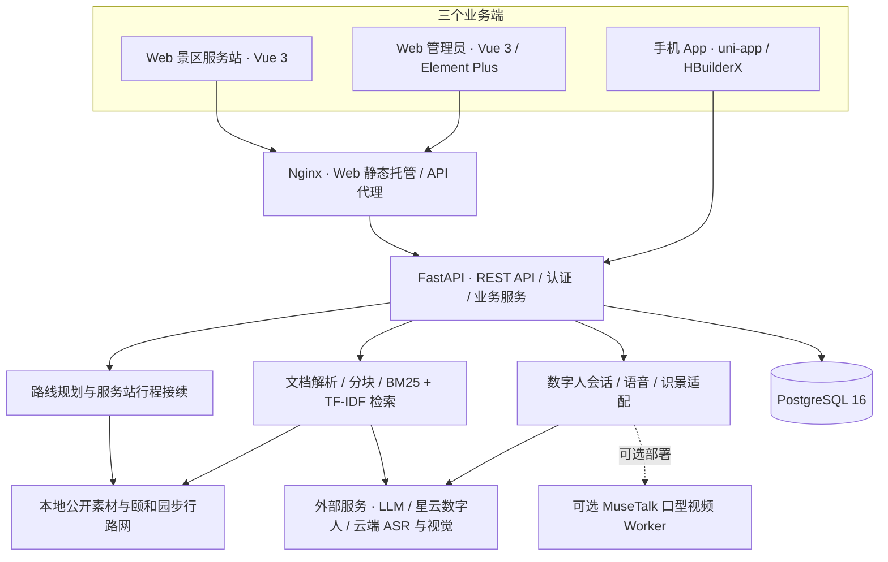

# WiseVoyage Realm · 智游知境

**面向颐和园的三端智能导览系统：Web 景区数字人服务站、手机 App、Web 管理员端。**

游客在服务站咨询并规划游览路线，通过二维码或领取码把行程带到手机，随后在 App 中继续景点讲解、数字人问答和路线查看。管理员在同一套后台维护景点、路线、数字人、知识文档和服务站，并查看导览与反馈数据。

本仓库是颐和园交付范围的源码快照。三个业务端共用 FastAPI 后端与 PostgreSQL 数据库；没有额外的游客 Web 产品端。默认服务使用 CPU 即可运行，数字人实时呈现和大模型能力按配置对接外部服务。

## 功能

### Web 景区服务站

- 按服务站标识进入咨询页，以站点作为路线规划起点。
- 根据游览时间、兴趣和出口等条件规划多景点步行行程，查看路线、停留时间和分段信息。
- 使用数字人讲解、文字问答和语音相关交互，结合景点图片与知识资料辅助理解。
- 生成路线二维码与 **12 位领取码**，让手机 App 接续服务站行程。
- 支持中文、英文界面；站点咨询会话与游客个人导览会话分别管理。

### 手机 App

- iOS / Android 共用一套 uni-app Vue 3 源码。
- 浏览颐和园景点、查看详情、选择和调整路线、选择数字人并开始导览。
- 扫描站点二维码或输入领取码，登录后接续路线。
- 在导览过程中查看当前景点、路线和讲解，与数字人进行问答。
- 提供语音输入、拍照识景、历史记录与反馈等能力；相机、麦克风、定位及音频表现需要目标设备验证。
- 支持中文、英文，并允许在登录页切换连接的服务站地址。

### Web 管理员端

- 管理服务站、景点档案、预设路线、数字人形象及平台应用绑定。
- 上传 PDF、Word、TXT、Markdown 知识文档；管理员提交后自动收录并更新检索索引。
- 重建知识索引、运行知识问答评测，查看题目、回答和关键词覆盖结果。
- 查看导览会话、游客反馈、分析看板与系统配置状态。
- 数字人平台凭据由后端加密存储；公开资源包不包含可直接使用的应用密钥。

## 系统架构



Web 两端共享前端工程、路由、语言包和认证状态；App 是单独的原生客户端工程。后端集中处理权限、业务数据、外部平台凭据和服务调用。浏览器与 App 不应保存服务端模型密钥。

### 路线规划与跨端接续

规划使用颐和园步行路网和景点坐标，综合步行、停留、休息等时间，而非简单按直线距离排列景点。预设路线与动态推荐资料共同服务于规划，因此界面中的推荐数量不一定等于数据库中预设路线的数量。

服务站生成行程快照和领取凭据，App 登录后完成领取，继续选择数字人并创建个人导览。领取流程目前按**局域网 HTTP、后端 18000 端口**实现和验收；公网 HTTPS 领取需要另行适配，不能由登录地址支持 HTTPS 推断为已完成。

### 知识增强问答（RAG）

文档上传后经过解析、分块与索引，查询时结合 **BM25 和字符级 TF-IDF** 检索，通过融合排序选择上下文，再由配置的大模型生成回答。默认链路不要求向量数据库或 GPU。

系统保留按当前景点/对象过滤知识的规则。管理员上传直接自动收录；从资源包导入的待发布内容通过维护脚本发布。评测使用固定题库和关键词覆盖规则，结果用于回归检查，不能等同于任意问题的事实正确率。

### 数字人与权限

星云数字人负责实时角色呈现，后端为平台会话签发受限凭据。账号使用 JWT 认证，数字人应用密钥加密保存在数据库中；JWT 密钥需要妥善备份，随意更换会影响原有凭据解密。

语音识别、视觉识景、模型问答和部分素材生成依赖相应外部平台。Edge-TTS 和可选本地口型 Worker 保留在现有服务能力中。**外部服务“已配置”表示存在配置，不表示当前网络、额度和平台调用均已验证成功。**

## 颐和园数据

公开内容包为 [`resources/summer-palace-content.zip`](resources/summer-palace-content.zip)，附带 SHA-256 校验文件，可导入已初始化的空数据库。

- **16 个景点**：仁寿殿、长廊、佛香阁、昆明湖、十七孔桥、苏州街、乐寿堂、玉澜堂、排云殿、谐趣园、石舫、玉带桥、南湖岛、铜牛、德和园、文昌阁。
- **3 条数据库预设路线**及路线景点关联。
- **2 个数字人展示配置**；导入后需重新绑定实际平台应用并启用。
- **24 份知识文档**及对应公开素材。
- 用于规划的步行网络、坐标、推荐路线资料与来源说明。

公开仓库不包含实际账号、密码、游客会话、领取凭据、私有照片、数据库备份或模型密钥。它提供可复现的公开业务内容，不复制现有部署的私人数据库。

## 目录

```text
WiseVoyage-Realm/
├─ frontend/                 # Web 服务站、管理员及共用组件
├─ app/                      # uni-app 原生 App、SDK、测试与编译脚本
├─ server/
│  ├─ base/                  # FastAPI、业务接口、模型、检索与平台适配
│  └─ digital_human/         # 可选本地口型视频 Worker
├─ shared/                   # 共用坐标、图标等跨端资源
├─ data/                     # 颐和园路网、知识目录、路线与来源资料
├─ static/                   # 公开知识原文、景点图片及数字人封面
├─ resources/                # 脱敏内容包、校验文件与导入说明
├─ scripts/                  # 数据导入导出、发布、连接与交付验证工具
├─ requirements/             # 默认后端及可选 Worker 依赖
├─ docker/                   # 后端 / Web Dockerfile 与 Nginx 配置
├─ docs/                     # 架构专题、来源、部署及交付记录
├─ compose.yaml
├─ .env.example              # 配置模板，不包含真实密钥
└─ LICENSE
```

编译产物、依赖目录、运行日志、缓存、真实 `.env` 和数据库备份不提交 Git。`static/` 中跟踪的公开素材与公开内容包用于复现内容；新增私有上传文件应保留在运行环境中。

## 技术栈与环境

- **后端**：Python 3.12、FastAPI、SQLModel / SQLAlchemy、PostgreSQL 16、scikit-learn。
- **Web**：Vue 3、TypeScript、Vite 5、Element Plus、Pinia、Axios、ECharts、Leaflet。
- **App**：uni-app Vue 3、HBuilderX、renderjs；数字人 SDK 和 Leaflet 随 App 固定打包。
- **基础设施**：Node.js 22、Docker Compose、Nginx、FFmpeg。
- **交付编译基线**：HBuilderX 的 **5.07 Vue 3 编译器插件**；App 编译器随 HBuilderX 提供，不能直接用普通 Vite 构建替代。

依赖以各工程锁文件和 `requirements/` 为准。默认后端不安装 PyTorch / CUDA；需要本地 MuseTalk 时，再单独处理 `requirements/digital_human.txt`、模型权重和硬件环境。

## 本地启动

以下命令以 Windows PowerShell 为例，在仓库根目录执行；先安装 Git、Python、Node.js、Docker Desktop。

### 1. 获取源码与填写配置

```powershell
git clone https://github.com/zixuan668/WiseVoyage-Realm.git
cd WiseVoyage-Realm
Copy-Item .env.example .env
```

编辑 `.env`，至少完成：

- `POSTGRES_*`：数据库连接和强密码；本机端口默认 **25432**。
- `ADMIN_USERNAME`、`ADMIN_PASSWORD`、`ADMIN_EMAIL`：空数据库首次启动时创建的管理员。没有公开通用密码。
- `TOKEN_JWT_SECURITY_KEY`：独立随机密钥，可用 `python -c "import secrets; print(secrets.token_hex(32))"` 生成。
- `LLM_API_BASE`、`LLM_API_KEY`、`LLM_MODEL_NAME`：实际可用的模型服务配置。
- `PUBLIC_SERVER_ORIGIN`：电脑的实际局域网后端地址，例如 `http://192.168.1.20:18000`。**执行任何 Compose 命令前都要填写**，因为 Compose 会校验整份配置。

邮箱注册、云端语音识别、识景和数字人等功能还需要对应配置。`FFMPEG_PATH` 可指定本机 FFmpeg；Docker 后端镜像已安装 FFmpeg。数字人应用凭据通过管理员端绑定，不填写到前端文件中。

### 2. 启动数据库与后端

```powershell
docker compose up -d database
python -m venv .venv
.\.venv\Scripts\Activate.ps1
python -m pip install -r requirements.txt
.\start_backend.ps1
```

后端监听 `http://localhost:18000`；OpenAPI 文档为 `http://localhost:18000/docs`。首次启动初始化表结构和管理员。终端应保持运行。

数据库容器名为 `zhiyou-zhijing-database`，命名卷为 `zhiyou-zhijing-postgres`，数据库名默认 `streamer_sales_db`（保留兼容命名）。已有部署应使用现有配置和数据，不重复初始化，也不要删除数据卷。

### 3. 导入公开内容

后端完成首次初始化后，另开已激活同一虚拟环境的终端：

```powershell
Expand-Archive -LiteralPath resources/summer-palace-content.zip -DestinationPath resources
python scripts/import_resource_pack.py resources/summer-palace-content
python scripts/publish_submitted_knowledge.py --user-id 1
```

`--user-id 1` 适用于新库首个管理员；已有数据库应使用实际管理员 ID。导入脚本保留已有同名内容并校验文件。已有完整颐和园内容的数据库不需要重复导入。进入管理员端后重新绑定数字人平台应用并启用，否则公开包本身不能提供可用的云端数字人会话。

### 4. 启动 Web

```powershell
cd frontend
npm ci
npm run dev
```

- 服务站：`http://localhost:5173/station/summer-palace-east`
- 管理员入口：`http://localhost:5173/admin`，未登录时进入登录页。

开发服务器代理后端；生产环境由 Nginx 提供页面刷新回退与 API 代理。Web 两端共用一个构建产物。

## 手机运行与打包

1. 启动后端，确保手机与电脑网络互通；电脑插上网线不代表手机自动能访问电脑。
2. 在 HBuilderX 导入仓库中的 `app/`，安装 App 真机运行插件和 Vue 3 编译器。保留完整仓库结构，App 会引用 `shared/` 和 Web 英文语言资源。
3. 在仓库根目录配置地址：

```powershell
.\scripts\configure_app.ps1 -ServerAddress http://192.168.1.20:18000
```

4. 先在手机浏览器打开 `http://192.168.1.20:18000/api/v1/tour-session/spots`，能看到数据后，再通过 HBuilderX 运行到手机。

Android 可使用 USB 调试与 `scripts/connect_device_backend.ps1` 恢复后端反向转发。iPhone 通过局域网或个人热点访问后端，并需要已签名基座或正式安装包；USB 同步源码不能替代网络连接。

需要恢复 App 的 npm 依赖时，在 `app/` 执行 `npm ci --legacy-peer-deps`，避免锁定依赖中的旧 peer 声明阻止安装。不要随意升级 DCloud 编译依赖。

仅编译 App 原生资源：

```powershell
.\app\scripts\build-app.ps1 -HBuilderX E:\HBuilderX -ServerOrigin http://192.168.1.20:18000
```

输出在 `app/unpackage/dist/build/app-plus/`。**编译资源不是已签名的 APK / IPA**；独立安装包仍需 HBuilderX 发行流程、原生权限配置和签名。HBuilder 标准测试基座显示“本应用无法独立运行”时，需要重新通过电脑 HBuilderX 同步项目。

详细说明见 [App 开发与验证](app/README.md)、[iPhone 测试](docs/iphone-testing.md)、[路线领取](docs/app-pickup.md)。

## Docker 部署

设置好 `.env` 和 `PUBLIC_SERVER_ORIGIN` 后：

```powershell
docker compose up -d --build
```

- Web：`http://部署电脑:8080`，包含服务站和管理员。
- 后端：`http://部署电脑:18000`。
- 数据库：仅绑定宿主机 `127.0.0.1:25432`，容器之间使用内部 5432。

空环境仍需在数据库初始化后导入公开内容，并配置需要的外部服务。可在宿主机解压资源包后，通过 `docker compose cp` 将目录复制到后端容器，再用 `docker compose exec base python ...` 执行同一导入和发布脚本。

生产 Web 构建时读取 `PUBLIC_SERVER_ORIGIN`；电脑地址变化后需要重新构建 Web 并更新手机地址。迁移现有部署时，先备份数据库，处理重复容器和端口占用，保留现有命名卷。不要使用删除数据卷的命令代替迁移。

Dockerfile 明确复制业务文件，真实 `.env` 不进入镜像。公开网络部署还应设置域名、HTTPS、访问控制和备份策略；当前局域网领取方式不能直接视作公网部署验收。

## 测试与交付检查

```powershell
# Web：单元测试、类型检查与生产构建
cd frontend
npm run test:unit -- --run
npm run build
cd ..

# App：无需手机的单元检查及 SDK 发布检查
node --test app/tests/*.test.cjs
node app/scripts/verify-avatar-release.cjs

# 验证源码、资源包；加 --database 只读验证当前颐和园交付数据库
python scripts/check_delivery.py
python scripts/check_delivery.py --database
```

2026-10-26 清理交付基线记录：Web **160** 项、App **133** 项、后端 **197** 项测试通过，Web 生产构建、App 原生资源编译及 Nginx 页面/API 代理检查通过。记录见 [交付验证摘要](docs/delivery-verification.json)、[清理清单](docs/delivery-cleanup.md)。这些是交付快照的验证记录，不是持续更新的 CI 状态。

后端回归位于 `scripts/tests/`，应在隔离测试数据库环境中执行，不能对游客正在使用的数据库运行测试。浏览器回归使用本机浏览器与单独生成的 App H5 测试资源，仅用于验证同一份 App 源码。

## 已知限制与验收范围

- **iPhone 数字人声音仍需真机验收**：此前目标设备存在无声反馈；浏览器音频通道测试不能证明 iPhone 已恢复可听声音或声画同步。
- **未随仓库提供正式签名安装包**：iOS 证书、设备信任、原生权限和外部扫码唤起需在最终安装包验收。
- **路线领取当前限于局域网 HTTP 18000**；普通服务地址支持 HTTPS，不代表公网领取已经适配。
- **不提供景区实时开放/封路数据接入保证**：步行网络、景点知识和通行资料属于内容基线，不是实时现场状态。
- **云服务需要真实账号、网络和配额**；密钥存在不代表服务可用，调用可能产生费用。
- **知识评测不承诺固定通过率**：历史扩充记录只对应当时模型和题库；更换模型或资料后应重新评测，当前模型没有在本次发布中重跑收费答题评测。
- **可选 GPU Worker 不属于默认安装验证范围**；完整后端 Docker 镜像也未在本次交付中进行从零构建验收。

## 延伸文档

- [Web 服务站](docs/web-service-station.md) · [跨端领取](docs/app-pickup.md)
- [步行路线规划](docs/pedestrian-route-planning.md) · [路线顺序优化](docs/route-order-optimization.md)
- [知识自动收录](docs/knowledge-auto-publication.md) · [知识与对话](docs/tour-knowledge-and-dialogue.md)
- [数字人集成](docs/xingyun-integration.md) · [中英文与音色](docs/application-language-and-voice.md)
- [资源包](docs/resource-pack.md) · [内容来源审计](docs/content-source-audit.md) · [图片来源](docs/image-credits.md)

## 许可证与致谢

代码按仓库中的 [GNU AGPL v3](LICENSE) 发布。项目包含由 [Streamer-Sales](https://github.com/PeterH0323/Streamer-Sales) 演进的代码，保留其作者与版权声明，并在现有代码基础上完成景区业务改造；第三方代码与素材遵循各自许可证，不能仅以本项目许可证替代。

感谢 Vue、uni-app、FastAPI、PostgreSQL、Leaflet、Lucide 等开源项目。地图、图片、知识资料和数字人 SDK 的来源及许可见 `docs/`、`shared/` 和相应资源目录；外部平台商标、服务及数字人素材的使用仍受其各自条款约束。
